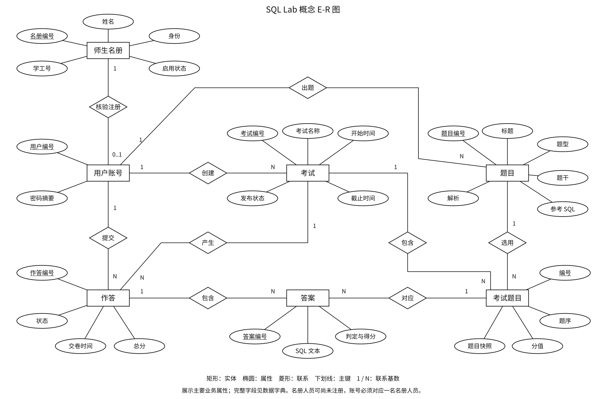
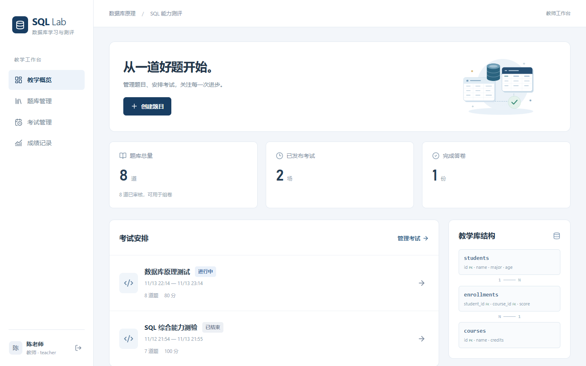
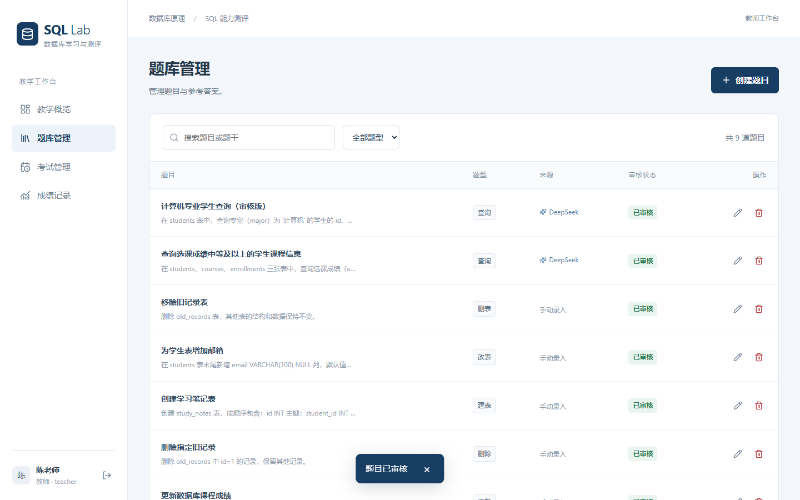
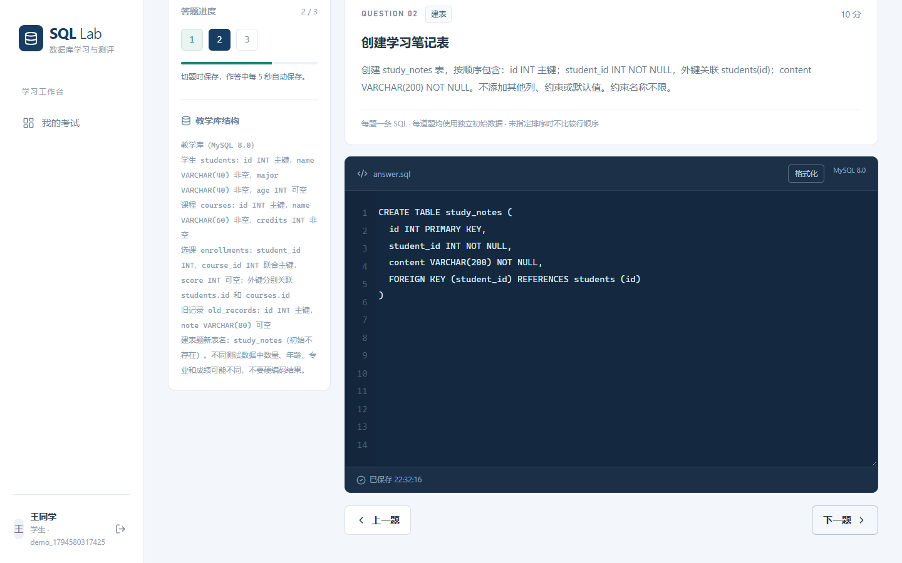
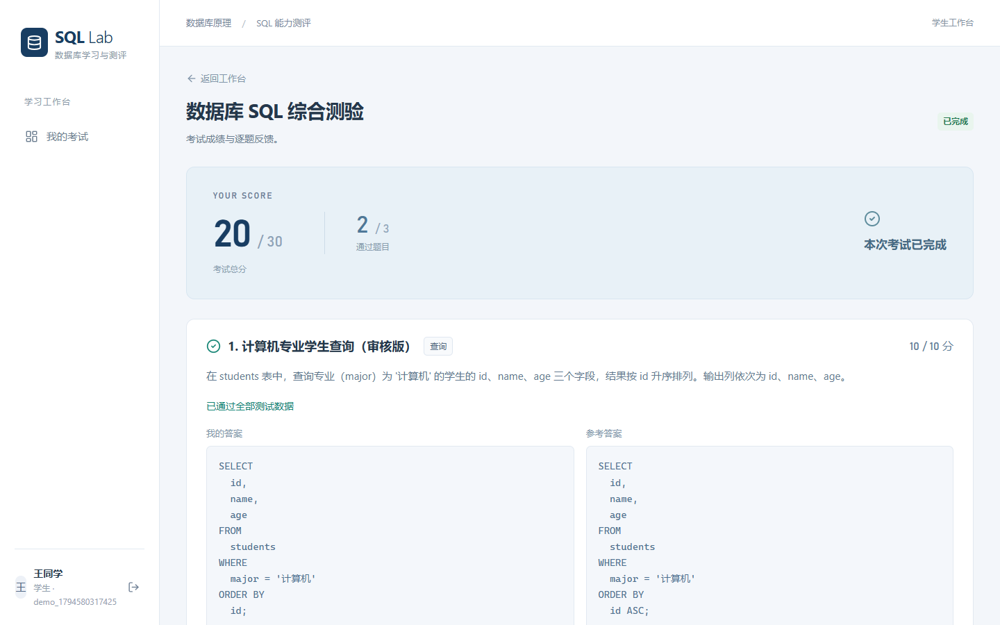

# SQL Lab 数据库 Web 应用实验报告

本实验开发面向数据库课程的 SQL 出题与考试判题系统。教师通过题库管理和 DeepSeek 辅助生成题目，审核后组卷发布；学生在统一时间窗内作答，系统保存答案并依据真实 MySQL 执行结果判分。本报告依次说明需求、数据库设计、前后端实现、测试方法和实验结果。

## 1 实验目的与任务

实验目标是将需求分析、概念建模、关系模式设计、Web 开发和测试连接为一个可演示的应用。系统应能够管理真实持久化数据，现场完成新增、修改和删除操作，并给出能够复查的设计与测试材料。

本项目选取“基于大语言模型生成 SQL 题目的考试判题系统”。实现范围包括教师与学生身份、七类单条 SQL 题目、AI 草稿生成、执行审核、限时考试、自动保存、交卷计分和结果解析。AI 用于辅助出题及提供参考解析，正确性判定由程序和 MySQL 执行结果承担。

| 实验要求 | 本项目交付 |
|---|---|
| 需求分析 | 用户角色、业务流程、功能需求、业务规则与范围 |
| 数据库设计 | 中文 E-R 图、关系模式转换、六类核心实体与辅助会话表、数据字典 |
| 前后端设计与开发 | Vue 3 页面、Express 接口、MySQL 业务库与专用判题库 |
| 测试及用例 | 17 项基础与安全测试、19 项真实 MySQL 集成测试，60 条场景用例记录 |
| 现场演示 | 题库增删改、AI 出题审核、组卷、学生答题与结果反馈，教师端和学生端录屏 |

## 2 实验环境与运行方式

| 项目 | 实际环境或选型 |
|---|---|
| 操作系统 | Windows，本机运行 |
| JavaScript 运行时 | Node.js 22.23.2 |
| 数据库 | MySQL 8.0.44，InnoDB，utf8mb4 |
| 前端 | Vue 3、Vue Router、Vite，统一浅色页面与 SQL 编辑区 |
| 后端 | Express、mysql2、持久化会话、scrypt 密码摘要 |
| AI 服务 | DeepSeek 在线 API，密钥仅保存在本机后端配置 |
| 浏览器验证 | Microsoft Edge，Playwright 自动化 |
| 文档与用例 | Word 实验报告、Excel 测试用例表及仓库 Markdown 文档 |

系统由一个后端进程提供接口及前端生产静态文件。本机访问地址为 http://127.0.0.1:3000。业务库 sql_exam 保存用户、题目、考试与答卷，sql_exam_judge 为可重建的练习库。按项目 README 配置本机数据库后，依次执行 npm install、node scripts/init-env.js、npm run setup、npm run build 和 npm start。

初始化脚本建立数据库表、受限判题账号、演示用户、七类已验证题目及示例考试。组员拉取源码后须填写各自的数据库连接配置；源码仓库不包含本机 .env、数据库密码或 API 密钥。

## 3 需求分析

### 3.1 用户角色与业务流程

教师负责题库、题目审核、组卷发布和成绩查看。学生可自行注册，在考试开放后进入作答，并在交卷后查看本人成绩与解析。学生不能访问教师题库接口，也不能读取或代交其他人的答卷。

教师的主流程为“创建或生成题目草稿、核对题干与参考答案、执行验证审核、选择题目并设置时间和分值、发布考试、查看学生成绩”。学生的主流程为“注册登录、进入开放考试、编写并保存 SQL、提前交卷或等待截止、查看逐题反馈”。

### 3.2 功能需求

| 编号 | 功能 | 验收条件 |
|---|---|---|
| F01 | 注册登录与角色权限 | 注册固定为学生；教师和学生访问各自功能；密码不明文保存 |
| F02 | 题库新增修改删除 | 数据写入 MySQL；修改后恢复待审核；删除不破坏已发布快照 |
| F03 | DeepSeek 辅助出题 | 返回完整草稿；参考 SQL 统一换行缩进；生成结果须经教师审核 |
| F04 | 参考答案执行审核 | 在两组初始数据上验证参考 SQL，通过后才可组卷 |
| F05 | 组卷与统一时间窗 | 选择已审核题目和分值；结束晚于开始；发布后冻结题目内容 |
| F06 | 学生作答与恢复 | 每 5 秒及切题时保存；刷新后读取最后保存答案；每人每场一次 |
| F07 | 截止控制与交卷 | 服务器决定截止；到期按已保存答案交卷；重复交卷幂等 |
| F08 | 七类 SQL 自动判题 | 支持查询、插入、更新、删除、建表、改表和删表 |
| F09 | 成绩与参考解析 | 交卷后完成判题即可查看本人结果；异常不记零分，允许教师重试 |
| F10 | SQL 可读排版 | 关键字大写、子句换行、两空格缩进；不改变字面值或执行语义 |

### 3.3 业务规则与范围

每题仅提交一条 SQL，所有题目都从独立的初始数据开始，不依赖上一题的修改。查询题比较输出列与结果值并保留重复行；题干要求排序时才比较行顺序。数据修改题比较执行后的全部教学表，结构题比较列、主外键和唯一约束等信息。

每名学生每场考试仅创建一份答卷。交卷后不能继续修改，系统立即进入判题队列。所有测试数据通过时得单题满分，错误或空答案为零分；连接故障及参考答案故障标记为判题异常，成绩保持空值。已发布考试保存题目快照，避免题库变化影响历史答卷。

系统用于单机课程实验及小组演示，使用固定教学数据，不实现存储过程、触发器、任意数据库导入或监考。第一版采用单进程串行判题，未以高并发或长期公网运行作为验收目标。

## 4 数据库设计

### 4.1 概念结构

系统围绕用户、题目、考试、考试题目、作答、答案六类实体建模。题目和考试由教师创建；考试通过考试题目实体组织题序、分值和快照；学生参加考试产生作答，每份作答按考试题目保存对应答案。

### 4.2 E-R 图转换为关系模式

第一步，将六类实体各自转换为一张表，使用独立编号作为主键。教师和学生共享用户实体，通过 role 区分，避免重复维护两套账号信息。

第二步，将一对多联系转换为“多”端的外键。例如题目和考试中的 created_by 关联用户，作答中的 user_id、exam_id 分别关联学生和考试。

第三步，将考试与题目的多对多联系转换为 exam_questions 中间表，并保存该联系自身的题序、分值和题目快照。考试与用户之间的参与关系由 attempts 表表达，并对 exam_id、user_id 设置联合唯一约束。

第四步，用 answers 关联作答和考试题目，对 attempt_id、exam_question_id 设置联合唯一约束，保证一份答卷的同一道题只有一条当前答案。保存接口还核对题目与考试的归属，补充单列外键不能表达的业务约束。

| 关系模式 | 主键 | 外键及主要唯一性规则 |
|---|---|---|
| users 用户 | id | username 唯一 |
| questions 题目 | id | created_by 关联用户 |
| exams 考试 | id | created_by 关联用户；结束时间晚于开始时间 |
| exam_questions 考试题目 | id | exam_id、question_id 为外键；同卷题序、同卷题目分别唯一 |
| attempts 作答 | id | exam_id、user_id 为外键；同一考试与学生组合唯一 |
| answers 答案 | id | attempt_id、exam_question_id 为外键；二者组合唯一 |
| sessions 会话 | sid | 技术辅助表，按过期时间建立索引 |

身份与业务关联按实体拆分，以降低重复更新。题目快照和总分是有意保留的冗余：快照在发布时固定，总分在判题结果保存事务中统一维护，用于保证历史语义和查询便利性，不将它们描述为完全消除冗余的设计。

### 4.3 数据字典

下表列出业务字段。题型取 select、insert、update、delete、create_table、alter_table、drop_table；答卷状态取 active、queued、grading、graded、error。完整枚举值、默认值及约束以仓库 db/schema.sql 为准。

### 用户 users

| 字段 | 类型 | 约束 | 含义 |
|---|---|---|---|
|id|BIGINT UNSIGNED|主键 自增|编号|
|username|VARCHAR(32)|非空 唯一|用户名|
|name|VARCHAR(40)|非空|姓名|
|password_hash|VARCHAR(200)|非空|随机盐与 scrypt 密码摘要|
|role|ENUM|非空|教师或学生角色|
|created_at|DATETIME(3)|非空|创建时间|

### 题目 questions

| 字段 | 类型 | 约束 | 含义 |
|---|---|---|---|
|id|BIGINT UNSIGNED|主键 自增|编号|
|title|VARCHAR(160)|非空|标题或名称|
|type|ENUM|非空|SQL 题型|
|prompt|TEXT|非空|完整题干|
|reference_sql|TEXT|非空|参考 SQL|
|explanation|TEXT|非空|参考解析|
|target_table|VARCHAR(64)|非空|目标教学表|
|ordered|TINYINT(1)|非空|是否比较查询行顺序|
|source|ENUM|非空|手动或 DeepSeek 来源|
|status|ENUM|非空|业务状态|
|created_by|BIGINT UNSIGNED|非空 外键 users.id|创建教师编号|
|created_at|DATETIME(3)|非空|创建时间|

### 考试 exams

| 字段 | 类型 | 约束 | 含义 |
|---|---|---|---|
|id|BIGINT UNSIGNED|主键 自增|编号|
|title|VARCHAR(160)|非空|标题或名称|
|starts_at|DATETIME(3)|非空|统一开始时间|
|ends_at|DATETIME(3)|非空 晚于开始|统一截止时间|
|status|ENUM|非空|业务状态|
|created_by|BIGINT UNSIGNED|非空 外键 users.id|创建教师编号|
|created_at|DATETIME(3)|非空|创建时间|

### 考试题目 exam_questions

| 字段 | 类型 | 约束 | 含义 |
|---|---|---|---|
|id|BIGINT UNSIGNED|主键 自增|编号|
|exam_id|BIGINT UNSIGNED|非空 外键 exams.id|考试编号|
|question_id|BIGINT UNSIGNED|可空 外键 questions.id|题库题目编号|
|position|INT UNSIGNED|非空|题目顺序|
|points|INT UNSIGNED|非空 1至100|单题分值|
|snapshot|JSON|非空|冻结的题目内容|

### 作答 attempts

| 字段 | 类型 | 约束 | 含义 |
|---|---|---|---|
|id|BIGINT UNSIGNED|主键 自增|编号|
|exam_id|BIGINT UNSIGNED|非空 外键 exams.id|考试编号|
|user_id|BIGINT UNSIGNED|非空 外键 users.id|学生编号|
|status|ENUM|非空|业务状态|
|started_at|DATETIME(3)|非空|进入考试时间|
|submitted_at|DATETIME(3)|可空|交卷时间|
|score|INT UNSIGNED|可空|总分或单题得分|
|error_message|VARCHAR(300)|可空|判题异常说明|

### 答案 answers

| 字段 | 类型 | 约束 | 含义 |
|---|---|---|---|
|id|BIGINT UNSIGNED|主键 自增|编号|
|attempt_id|BIGINT UNSIGNED|非空 外键 attempts.id|作答编号|
|exam_question_id|BIGINT UNSIGNED|非空 外键 exam_questions.id|考试题目编号|
|sql_text|TEXT|非空|学生 SQL 答案|
|saved_at|DATETIME(3)|非空|最近保存时间|
|score|INT UNSIGNED|可空|总分或单题得分|
|verdict|ENUM|可空|正确 错误 空答案或异常|
|feedback|TEXT|可空|判题反馈|

### 4.4 完整性与删除策略

主键保证实体可识别，外键保证引用存在，唯一约束防止重复用户名、重复参加考试和重复答案。CHECK 约束限制考试时间顺序和题目分值。已发布考试在应用层禁止编辑和删除；只有草稿考试允许删除，其考试题目随之级联清理。

题库题目删除时，考试题目中的 question_id 置空，snapshot 保留。由此可以删除题库记录，而历史试卷仍能够解释当时的题干、参考 SQL 和得分依据。历史答卷不执行随意级联删除。

## 5 前后端设计

### 5.1 页面结构与导航

| 页面与路由 | 使用角色 | 主要内容与交互 |
|---|---|---|
| 登录注册 /login | 未登录用户 | 登录、学生注册、字段校验和错误提示 |
| 概览 / | 教师及学生 | 教师查看题库与考试概览；学生查看考试安排与作答状态 |
| 题库 /questions | 教师 | 搜索筛选、草稿编辑、AI 生成、验证审核、删除确认 |
| 考试 /exams | 教师 | 创建及编辑草稿、选题分值、起止时间、发布冻结 |
| 答题 /attempt/:id | 学生本人 | 题目导航、库表结构、SQL 编辑与格式化、保存状态、倒计时与交卷 |
| 结果 /result/:id | 本人及教师 | 总分、逐题判定、多行答案对照和参考解析 |
| 成绩 /results | 教师 | 学生记录、交卷时间、成绩、答卷明细和异常重判 |

前端路由守卫处理未登录跳转和教师页面可见性，但不将其作为安全边界。后端在每个敏感接口重新核对身份、角色与答卷归属。页面采用统一导航和简约排版，重要操作保留确认或保存状态，减少与用户操作无关的提示。

答题页在加载时获取服务端时间与截止时间，维护倒计时显示；每 5 秒及切题时保存答案。页面刷新从服务端恢复，未保存的修改会显示状态提示。客户端倒计时仅用于展示，是否允许保存最终由后端检查。

### 5.2 后端模块与接口

| 模块 | 文件 | 职责 |
|---|---|---|
| 身份与会话 | server/auth.js | scrypt 摘要、会话持久化、登录和角色检查 |
| 路由与参数校验 | server/app.js | 注册登录、题库、考试、作答和成绩接口，统一错误响应 |
| 考试与队列 | server/exams.js | 保存事务、交卷幂等、到期扫描、判题工作器和重启恢复 |
| SQL 判题 | server/judge.js | AST 校验、限时执行、练习库重建、数据与结构比较 |
| AI 出题 | server/ai.js | DeepSeek 请求、返回字段校验和参考 SQL 排版 |
| 数据与排版 | server/db.js、shared/sql.js | 数据库连接和事务；前后端共用 SQL 格式规则 |

接口采用 /api 前缀和 JSON。身份接口处理注册、登录、退出与当前用户；教师题库接口处理增删改、生成与审核；考试接口处理组卷和发布；答卷接口处理进入、保存、交卷与结果；成绩接口仅允许教师查询全体记录和重试异常答卷。未登录返回 401，越权返回 403，状态冲突返回 409，基础设施故障与模型故障保留可理解的错误反馈。

### 5.3 状态与事务

题目状态为 draft 和 approved，编辑后恢复 draft。考试状态为 draft 和 published，发布时在事务内重新核对已审核题目并保存快照。答卷状态依次经历 active、queued、grading、graded；异常进入 error，教师可以重新排队。

保存和交卷对答卷加行锁，避免保存请求覆盖已交卷内容。保存接口在事务中检查截止时间；已经到期时只接受此前保存的答案，并将答卷置为 queued。重复交卷不会创建第二份答卷或重复累加得分。逐题结果与总分在同一事务中保存。

## 6 核心实现

### 6.1 七类 SQL 判题

判题器为每题准备两组数据，覆盖不同学生数量、专业、年龄、重复成绩和空值。参考 SQL 与学生 SQL 分别在相同的初始环境执行，以降低硬编码固定答案的机会。

| 题型 | 比较内容 |
|---|---|
| SELECT | 列顺序、值、NULL、重复行；有排序要求时比较行顺序，忽略列别名 |
| INSERT UPDATE DELETE | 全部教学表执行后的数据及结构，防止误改其他表 |
| CREATE TABLE ALTER TABLE | 列顺序、类型、可空性、默认值、主键、外键、唯一约束及应保留数据 |
| DROP TABLE | 目标表是否删除，其他表结构和数据是否保持正确 |

MySQL 的 DDL 不能仅靠事务回滚恢复。因此每次判题前后重建专用练习库，并采用串行执行避免不同任务互相影响。结构比较忽略约束名称，但保留复合键的字段组合和外键行为。

### 6.2 SQL 限制与账号隔离

输入经过 MySQL 方言 AST 解析，限制题型、教学表、单条语句和课程常见函数，拒绝跨库访问、变量、管理操作和危险函数。判题账号只有练习库内必要的数据与结构权限，不能读取业务用户表。执行默认限时 3 秒，查询流式读取，超过 1000 行或约 200 KB 时终止。

校验层和数据库权限层各自承担约束，避免只依赖前端或单一字符串规则。数据库连接失败和参考答案失效属于系统问题，不能作为学生答错处理。

### 6.3 AI 与 SQL 排版

DeepSeek 接收固定教学库结构、题型和教师要求，返回标题、题干、参考 SQL、解析、目标表和排序要求。后端校验返回字段和语句类型，再将 SQL 统一为关键字大写、子句换行和两空格缩进。

前后端共用格式化模块，教师编辑区和结果页采用相同样式，学生可主动点击“格式化”。格式化失败或答案尚未完成时保留原文，不把排版功能当作语法裁判。新增测试比较语法树和真实执行结果，确认排版不改变字符串字面值、约束或判题结果。

AI 请求超时独立处理。题目在考试前审核并发布，交卷和计分不需要实时调用模型。执行验证只能确认参考 SQL 在测试数据上可用，题意与参考答案是否一致仍由教师审核。

## 7 测试方法与用例

### 7.1 测试组织

基础测试验证密码摘要、输入校验、结果标准化和 SQL 排版；真实 MySQL 集成测试验证七类题型、权限隔离、资源限制、快照、保存、截止、异常重试和恢复。浏览器测试通过教师与学生页面完成端到端操作，补充验证自动保存、刷新恢复和移动端布局。

共执行 17 项基础与安全测试及 19 项集成测试，均通过。按业务场景进一步拆分为 60 条可复查用例，记录在“测试用例.xlsx”，包含编号、模块、前置条件、输入步骤、预期结果、实际结果、状态和验证依据。测试函数数量与业务用例条数采用不同统计口径，不混为同一指标。

### 7.2 代表性用例

| 场景 | 操作与输入 | 预期结果 | 实测结果 |
|---|---|---|---|
| 查询正确与错误答案 | 正确筛选排序；对照 SELECT * 等错误答案 | 正确通过，错误拒绝 | 符合预期 |
| 建表漏外键 | 创建相同字段但不声明外键 | 判错 | verdict=wrong |
| 改表漏唯一约束 | 只添加邮箱列，不添加 UNIQUE | 判错 | verdict=wrong |
| 等价 SQL | 使用别名、IN 条件或不同约束名称 | 效果相同时通过 | verdict=correct |
| 重复行与排序 | 错误 DISTINCT 或逆序输出 | 有重复或排序差异时判错 | 均被判错 |
| 截止后保存 | 到期后试图覆盖已保存答案 | 拒绝晚到写入 | 返回 409，原答案用于计分 |
| 判题连接异常 | 临时令测试判题连接失败 | 异常不记零分 | error 且 score=NULL |
| 模型不可用 | 禁用模型配置后参加已发布考试 | 仍可交卷计分 | 答卷 graded，得分正确 |
| SQL 格式化 | 对查询和建表答案统一换行缩进 | 不改变语义与判题结果 | 两类答案仍通过 |

### 7.3 执行结果与证据

| 验证项目 | 命令或方法 | 结果 |
|---|---|---|
| 基础与安全测试 | npm test | 17 项通过，0 失败 |
| MySQL 集成测试 | npm run test:live | 19 项通过，0 失败 |
| 前端生产构建 | npm run build | 构建成功 |
| DeepSeek 实际调用 | scripts/check-ai.js | 生成查询题并通过两组数据验证 |
| 真实进程恢复 | scripts/check-restart.js | 停止并重启服务后，会话、待判任务与离线到期答卷恢复 |
| 浏览器端到端 | scripts/check-ui.js | 教师管理与学生考试流程通过，20/20 分，无页面脚本异常 |
| 汇报录屏 | 教师端与学生端实操 | 三题中故意错答改表题，实际 20/30 分，正确展示反馈 |

测试中的临时用户、题目、考试和答卷在结束时清理，练习库只存放可重建数据。集成测试不与正常考试并行使用同一判题库。没有执行的高并发、长期运行和公网可用性检查不计入通过项目。

## 8 系统运行结果

### 8.1 教师概览与题库

教师工作台展示题库、考试及成绩入口。题库支持草稿新增、编辑和删除，AI 生成的题目保留来源，审核通过后可用于组卷。演示中实际完成了题目修改后重新审核，体现审核状态与内容变化的关联。

### 8.2 学生答题与多行 SQL

答题页展示库表结构、题干、统一截止倒计时和保存状态。示例建表答案按字段和约束换行显示；“格式化”按钮可改善学生输入的可读性。刷新后能够恢复已经保存的答案。

### 8.3 得分与逐题反馈

演示试卷包含查询、建表和改表三题，各 10 分。查询与建表正确，改表题故意遗漏邮箱唯一约束，因此结果为 20/30 分。结果页对照展示学生答案、格式化参考 SQL 和解析，可以定位结构性错误。

## 9 实验结论

系统已实现题库管理、AI 草稿生成与执行审核、限时组卷考试、答案持久化、七类 SQL 判题和成绩反馈，能够在本机完成实验要求的 Web 操作演示。中文 E-R 图、关系模式、数据字典、源代码和测试用例共同解释了从需求到实现的设计过程。

测试验证了等价查询、重复行、表约束、截止保存、越权访问和异常恢复等关键行为。真实数据库执行结果能够支持当前固定教学场景，但两组数据并不构成任意 SQL 等价性的数学证明。后续扩展需要增加题目数据覆盖、人工审核机制和独立资源隔离，再评估并发与长期运行。

## 10 小组信息与参考资料

小组成员、学号、班级与实际分工在封面填写。现场报告可按“需求与数据库设计、教师操作、学生考试与判题、测试结论”的顺序分配讲解，实际分工由小组确认。

参考资料包括课程实验任务书、MySQL 8.0 参考手册（https://dev.mysql.com/doc/refman/8.0/en/）、Vue 官方指南（https://cn.vuejs.org/guide/）、Express 官方文档（https://expressjs.com/）、DeepSeek API 文档（https://api-docs.deepseek.com/zh-cn/）。

源码仓库：https://github.com/Xixi051108/SQL-LAB 。配套材料包括中文 E-R 图、测试用例表、教师端操作视频和学生端操作视频。
